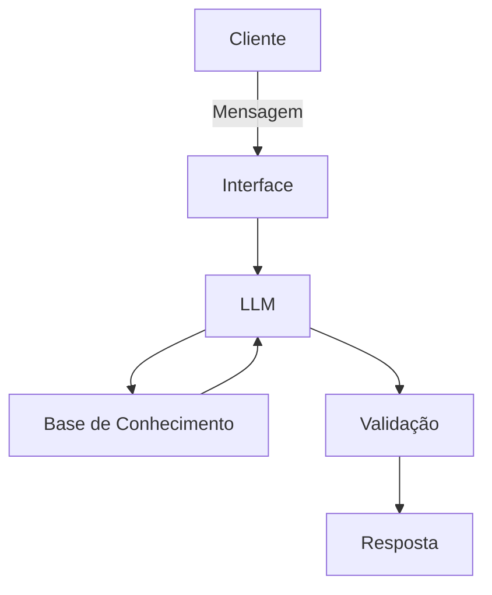

# Documentação do Agente

## Caso de Uso

### Problema
> Qual problema financeiro seu agente resolve?

Muitas pessoas possuem acesso ao histórico de suas transações financeiras, mas têm dificuldade em transformar esses dados em informações úteis para decidir:

-onde estão gastando mais;
-quanto conseguem economizar;
-quais categorias consomem maior parte da renda;
-se determinado objetivo financeiro parece compatível com sua situação;
-quais produtos disponíveis são adequados ao seu perfil.

### Solução
> Como o agente resolve esse problema de forma proativa?

O FIN.AI será um assistente financeiro baseado em IA capaz de interpretar uma base de dados financeira estruturada e responder perguntas em linguagem natural.
Exemplo:

Usuário: Onde estou gastando mais?
FIN.AI: Com base nas transações disponíveis,
sua maior categoria de despesas é Alimentação.
Total identificado: R$ 1.240,00.
Isso representa aproximadamente 32% das
despesas analisadas.

### Público-Alvo
> Quem vai usar esse agente?

Pessoas que querem compreender melhor suas finanças pessoais sem precisar analisar manualmente planilhas ou extratos.

---

## Persona e Tom de Voz

### Nome do Agente

FIN.AI

### Personalidade
> Como o agente se comporta? (ex: consultivo, direto, educativo)

-amigável;
-didático;
-objetivo;
-não julgador;
-cauteloso em assuntos financeiros;
-transparente sobre suas limitações

### Tom de Comunicação
> Formal, informal, técnico, acessível?

O FIN.AI utiliza uma comunicação acessível, amigável e didática, mantendo uma postura profissional. Evita jargões financeiros desnecessários e, quando utiliza algum termo técnico, explica seu significado de maneira simples. As respostas devem ser objetivas, claras e não julgadoras, ajudando o usuário a compreender suas informações financeiras e tomar decisões mais conscientes. Em situações que envolvam riscos, investimentos ou ausência de dados suficientes, o assistente adota um tom cauteloso e transparente, sem apresentar suposições como fatos.

### Exemplos de Linguagem

- Saudação: Olá! 👋 Eu sou o FIN.AI, seu assistente de saúde financeira. Como posso ajudar você com suas finanças hoje?
- Confirmação: Entendi! Vou analisar as informações disponíveis para ajudar você com isso!
- Erro/Limitação: Não encontrei informações suficientes na minha base para responder isso com segurança. Posso, porém, ajudar você a analisar os dados financeiros disponíveis.

---

## Arquitetura

### Diagrama

### Componentes

| Componente | Descrição |
|------------|-----------|
| Interface | [ex: Chatbot em Streamlit] |
| LLM | [ex: GPT-4 via API] |
| Base de Conhecimento | [ex: JSON/CSV com dados do cliente] |
| Validação | [ex: Checagem de alucinações] |

---

## Segurança e Anti-Alucinação

### Estratégias Adotadas

- [ ] [ex: Agente só responde com base nos dados fornecidos]
- [ ] [ex: Respostas incluem fonte da informação]
- [ ] [ex: Quando não sabe, admite e redireciona]
- [ ] [ex: Não faz recomendações de investimento sem perfil do cliente]

### Limitações Declaradas
> O que o agente NÃO faz?

[Liste aqui as limitações explícitas do agente]
